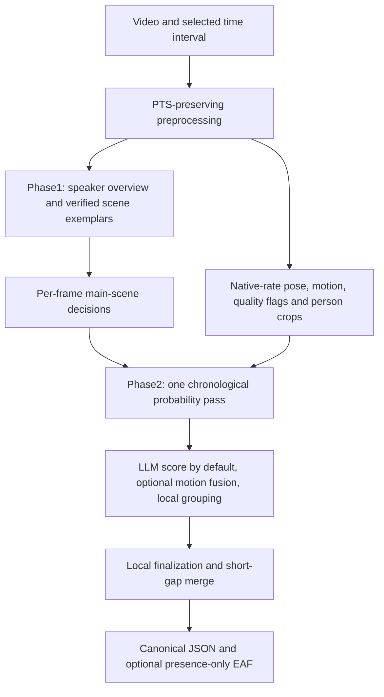

# Pipeline and output



With Phase1 disabled, operator-assumed scene membership replaces its overview and visibility calls. Preprocessing still runs. There are no separate transition, semantic interpretation or hand-attribution passes in Phase2 or finalization.

## Preprocessing and model input

FFmpeg probing preserves source presentation timestamps and timebases. Annotation samples form a 10 Hz grid. Pose inference runs on selected decoded source frames. Smoothing, track continuity, body-relative palm travel, palm rotation relative to the projected torso axis, and local finger articulation are computed locally. The same selected track supplies motion and crops. Degenerate geometry and scale discontinuities invalidate affected channels; potential isolated statistical spikes are separately flagged. Missing or rejected values remain unavailable, not zero motion.

Phase1 selects one recurring speaker, verifies positive scene exemplars and asks for a Boolean main-scene decision per current frame. A request contains at most five current frames by default. Its reference exemplars are separately labelled and are not output targets.

Before smoothing, a local source-frame scan marks abrupt, spatially broad camera edits. Pose segments and motion derivatives stop at detected boundaries, preventing velocity measurements across those edits. Cuts the detector misses can still contaminate motion estimates. Mixed-view samples can have unavailable motion while retaining visual evidence. This is a local preprocessing operation, not another LLM pass, and camera cuts do not automatically separate final G-units.

Each Phase2 call contains:

- Clean, labelled speaker crops for HISTORY, TARGET and LOOK-AHEAD frames.
- Numeric motion rows with global analysis indices, timestamps, column names, units and missing-value markers.
- Native palm observations and source timestamps where reliable.
- Measurement-quality flags and, by default, a labelled motion-trace image.
- Previous raw LLM estimates for available history, explicitly identified as estimates rather than physical evidence.

Targets and look-ahead stay inside one detected camera shot. Earlier same-speaker pictures remain available across cuts with explicit cut metadata, while previous LLM estimates are admitted only from the current shot and only if they were produced with the full configured same-shot history. The motion trace marks the cuts. The prompt explains that apparent changes in hand position, scale or orientation at a cut are not evidence of motion, onset or rest; genuine G-unit or non-G-unit continuity can cross a cut when hand behavior supports it.

Images are chronological frames/contact sheets, not an encoded video stream. The model returns only:

```json
{"non_g_unit_probability": [0.1, 0.2, 0.5]}
```

The array has exactly one finite number in `[0,1]` per target sample, in output-slot order. Zero means belief that the sample belongs to a communicative G-unit phrase; one means belief that it is outside. Communicative holds can have low values despite little motion. Incidental movement can have high values despite high speed. `render_system_prompt` in `pipeline/probability_pass.py` inserts the configured schedule and rest duration into `SYSTEM_PROMPT_TEMPLATE`; its version is saved with requests.

The [exact Phase2 prompt](phase2-prompt.md) reproduces the complete default system
message and user-message prefix, explains the configuration substitutions, and
links to the request builder. It also documents the unchanged sentence about
post-response combination, which applies only when optional numerical fusion is
enabled.

## Physical score and combination

For each hand, transport uses palm path divided by supported duration when coverage is sufficient, then falls back to palm speed or wrist speed. Accepted values are divided by their configured scales. Let:

- `T` = normalized transport;
- `R` = normalized palm-orientation speed relative to the torso axis, capped at 8;
- `F` = maximum of normalized finger-extension and articulation speeds, capped at 8;
- `w` = local-hand weight, default `0.25`.

The hand magnitude is `sqrt(T² + w × (R² + F²))`, using available components only. `m` is the largest available hand magnitude. The physical non-G score is `M = 1 / (1 + m)`. A quiet score (`M >= 0.5`) is used only with complete, unflagged transport and local-motion support from both hands, including all five fingers per hand; otherwise it is absent. Supported movement (`M < 0.5`) can still supply an anchor with partial observations. With no usable motion, `M` is absent. Reliability determines which measurements can be used; it is not a multiplier on speed. The exact computation is `motion_quality.score_measurement`.

Let `L` be the LLM's non-G probability. By default,
`probability_score_source = "llm"` uses the candidate score `Q = L`.
With the optional `probability_score_source = "motion_fusion"`, the score combines
physical motion and contextual LLM estimates. Let `s` be
`probability_context_strength`, default 4:

```text
Q = sigmoid(logit(clamp(M, 0.05, 0.95)) + s × (2L − 1))
sigmoid(x) = 1 / (1 + exp(−x))
logit(p) = log(p / (1 − p))
```

If `M` is absent, fusion falls back to `Q = L`.
The LLM receives all the motion inputs listed above in either mode.
Strength zero uses the
clamped motion score; it does not select LLM-only scoring. The raw LLM value,
physical score and selected candidate score are retained as
`llm_non_g_unit_probability`, `motion_non_g_probability` and
`non_g_unit_probability`. Neither symmetry nor motion magnitude alone determines
phrase membership. The two scoring modes have identical model inputs and prompts.

## Candidates and final decisions

Candidate grouping uses the selected score locally. Scores at or above `0.5` are initially rest. Such a run remains rest if it contains scores at or above `0.65` sustained for the configured separating-rest duration. Without that seed, weak rest may continue an established phrase only after consecutive scores below `0.5` have reached the configured minimum departure duration (300 ms by default). Weak rest alone cannot start a phrase. Short activity excursions, less than 300 ms by default, are discarded when surrounded by supported rest. Configured short compatible missing gaps may be bridged; exclusions and longer missing gaps reset continuation support. These are the default thresholds; the saved configuration governs each run.

Finalization accepts supported candidates without requiring observed rest beyond a clip or camera-cut edge. Unresolved internal gaps remain grounds for rejection. Final G-units separated by no more than `finalization_merge_gap_ms` are joined only when all intervening samples are eligible and have probability evidence. This cannot fill Phase1 exclusions, source/continuity barriers or unscored gaps. Compatible missingness already bridged during candidate creation is preserved. Original scores and deterministic overrides remain recorded. This is entirely local; it makes no LLM requests.

`annotations.json` is authoritative. It contains source and preprocessing identities, configuration, speaker/scene evidence, candidates, raw and final sample decisions, intervals and provenance. Times are integer microseconds and intervals are half-open. Evaluation and EAF export derive LLM-only intervals locally from saved raw estimates, even for a run whose canonical decisions used optional fusion. The source JSON is unchanged; output provenance records this distinction. EAF is rounded to milliseconds, with one `G-Units` tier and `G-unit` values, and does not require hand attribution.

## Method origins

The gesture-unit/phrase hierarchy and rest-to-rest organization draw on Kendon [1] and McNeill [2]. M3D [3, 4] informs the annotation interpretation of communicative manual activity, contextual full/partial rest, holds, and the 300 ms aid for ambiguous pauses. Our configurable duration and gap rules operationalize these ideas; they are not a claim of exact equivalence to human M3D annotation.

Pose estimation is supplied by rtmlib and RTMW3D [5, 6]. This application adds source-time alignment, selected-speaker association, geometry-based reliability checks, relative motion features, contextual image/motion requests, score fusion, automatic candidate grouping and resumable processing. The equations and algorithmic choices above belong to this implementation; neither their coefficients nor their performance are established by the cited annotation literature. The application does not implement M3D's full multidimensional labeling system or imply its authors' endorsement.

1. Kendon, A. (1980). Gesticulation and speech: Two aspects of the process of utterance. In *The Relationship of Verbal and Nonverbal Communication*, pp. 207–228. [DOI](https://doi.org/10.1515/9783110813098.207).
2. McNeill, D. (1992). *Hand and Mind: What Gestures Reveal about Thought*. University of Chicago Press. [Publisher](https://press.uchicago.edu/ucp/books/book/chicago/H/bo3641188.html).
3. Rohrer, P. L., et al. (2025). Multidimensional Labeling of Gesture in Communication: the M3D Proposal. *Corpus Pragmatics*, 9, 411–433. [DOI](https://doi.org/10.1007/s41701-025-00197-2).
4. Tütüncübasi, U., Ren-Mitchell, A., Shattuck-Hufnagel, S., Rohrer, P. L., & Prieto, P. (2023). *The M3D Training Program*: [Identifying G-Units](https://m3d.upf.edu/challenges/identifying-g-units).
5. [rtmlib](https://github.com/Tau-J/rtmlib): pose-model inference library used by this application.
6. [OpenMMLab MMPose](https://github.com/open-mmlab/mmpose): external pose-estimation project supplying the RTMW3D model family.

To cite this software, see [CITATION.cff](../CITATION.cff).
